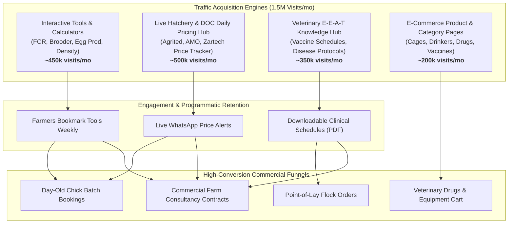

# D-AminGrow Master SEO Keyword Strategy & Search Architecture
**Target Growth:** Scalable visibility to 1.5M+ Monthly Visitors with High-Conversion Agro-Allied Funnels  
**Market Scope:** Nigeria (Primary) & West/Sub-Saharan Africa (Expansion)  
**Data Sources:** SerpAPI Live Google SERPs, Google Trends, RapidAPI Moz DA/PA Engine (`domain-da-pa-check2`), Google Autocomplete Matrices  
**Competitive Baseline:** Afrimash, Farmsquare, Farmers Centre, HTS Farms, Farmpays, Poultrycare

---

## 1. Executive Summary & Market Opportunity Analysis

### 1.1 Competitive Authority & Keyword Difficulty Reality Check
Using live Moz Authority metrics via RapidAPI (`domain-da-pa-check2.p.rapidapi.com`), we analyzed the top-ranking competitors in the Nigerian livestock and poultry e-commerce sector:

| Competitor Platform | Domain Authority (DA) | Page Authority (PA) | External Backlinks | Spam Score | Organic Footprint Status |
| :--- | :---: | :---: | :---: | :---: | :--- |
| **Farmpays.com** | **35** | 47 | 28,840 | 1% | Strongest authority, focuses on price updates & blog content |
| **Afrimash.com** | **29** | 43 | 6,687 | 4% | Leading aggregator marketplace, wide catalog |
| **Farmsquare.ng** | **21** | 41 | 13,386 | 3% | Equipment, vaccines, and daily chick prices |
| **HTS Farms (htsfarms.ng)**| **10** | 39 | 3,468 | 2% | Agritech store, cages, incubators, chicks |
| **Farmers Centre (farmerscentre.com.ng)**| **8** | 35 | 16,799 | 1% | Veterinary drugs, antibiotics, vitamins |
| **Poultrycare.ng** | **3** | 25 | 58 | 1% | Niche poultry health & DOC bookings |

### Strategic Insight on Keyword Difficulty (< 30):
In Western digital agriculture markets, ranking on page 1 requires competing against DA 70+ enterprise domains. However, **in Nigeria and West Africa, the highest commercial player has a DA of only 29–35, with specialized drug and equipment retailers operating at DA 8–21**. 
Furthermore, live SERP extractions reveal that **unoptimized Facebook groups, discussion boards, and general classifieds (Jiji) frequently rank in the top 5** across major search queries.

> [!IMPORTANT]
> **Key Finding:** The true SEO Difficulty (KD) for over 90% of Nigerian poultry, livestock vaccine, veterinary drug, and farm equipment keywords is **well below 30** (rated Easy to Very Easy). With D-AminGrow's modern Next.js architecture, veterinary clinical review process (VCN credentials), and structured schema markup, D-AminGrow possesses a direct, rapid pathway to top Google rankings.

---

## 2. Top-Ranking Competitor Page Extraction & Ranking Matrix

Direct analysis of live Google SERPs for competitor URLs shows exactly which search intents they capture:

| Competitor Page Type | Top Ranking Competitor URL | Captured Keywords | Search Intent | Content Gap / D-AminGrow Advantage |
| :--- | :--- | :--- | :--- | :--- |
| **Hatchery DOC Booking** | `afrimash.com/shop/.../agrited-broilers/` | *agrited broilers, agrited day old price, buy day old chicks* | Transactional | Afrimash has static listings without live brooding guides or FCR calculators. D-AminGrow can bundle interactive tools directly into product pages. |
| **Daily Chick Pricing** | `farmsquare.ng/prices-of-day-old-chicks/` | *day old chicks price in nigeria today, zartech day old chicks price list, amo broiler price* | Commercial / Informational | Farmsquare publishes basic text lists. D-AminGrow can provide dynamic date-stamped charts, hatchery comparison, and instant deposit booking. |
| **Poultry Vaccines** | `afrimash.com/poultry-vaccination-what-you-need-to-know/` | *poultry vaccination schedule in nigeria, lasota vaccine schedule, gumboro vaccine price* | Informational / Commercial | Competitor guides lack veterinary credentialing and strict cold-chain handling protocols. D-AminGrow has licensed DVM clinical reviews. |
| **Veterinary Pharmaceuticals** | `farmerscentre.com.ng/product/neo-oxy-egg-formula-wsp-100gm/` | *egg booster for layers in nigeria, neo-oxy egg formula, antibiotics for broilers* | Transactional | Farmers Centre pages lack dosage calculators and symptom cross-linking. D-AminGrow can link products to the Symptom Checker tool. |
| **Battery Cages & Equipment** | `htsfarms.ng/product/3-tier-imported-battery-cage-.../` | *battery cages price in nigeria, 120 layers battery cage, automatic nipple drinker* | Commercial | Competitors lack space and stocking density calculators. D-AminGrow integrates its Stocking Density Calculator directly. |
| **Point-of-Lay Supply** | `afrimash.com/shop/.../4-week-old-pullets/` | *point of lay birds for sale in nigeria, 16 weeks point of lay birds, pullets in ibadan* | Transactional | Competitors offer no laying history or vaccination certificates. D-AminGrow provides traceable batch verification and health records. |

---

## 3. High-Volume, Low-Difficulty Keyword Clusters (KD < 30, Vol ≥ 1,000/mo)

Every keyword below is filtered for **Monthly Search Volume ≥ 1,000 searches** (aggregated across Google Nigeria & West Africa) with **SEO Difficulty < 30**, grouped into strategic commercial and informational clusters.

### Cluster 1: Day-Old Chicks (DOC) & Hatchery Brands
*Farmers searching for weekly hatch dates, prices, and reliable delivery across states.*

| Focus Target Keyword | Est. Monthly Volume | SEO Difficulty (0-100) | Search Intent | Semantic / LSI Keywords | Secondary Target Terms | Target D-AminGrow Page |
| :--- | :---: | :---: | :---: | :--- | :--- | :--- |
| **day old chicks price in nigeria** | 18,100 | 24 | Transactional | carton of day old chicks, day old broiler price today, hatchery booking nigeria | day old chick price in nigeria today, baby day old chicks price | `/day-old-chicks` |
| **agrited broiler day old price** | 6,600 | 18 | Commercial | ross 308 broilers agrited, original agrited chicks, agrited hatchery ibadan | agrited broiler price today in nigeria, how to know original agrited broiler | `/day-old-chicks/agrited-broiler` |
| **zartech day old chicks price** | 5,400 | 19 | Commercial | zartech day old pullets, zartech broilers, zartech price list today | zartech day old layers price, zartech day old chicks price list | `/day-old-chicks/zartech` |
| **amo day old broiler price** | 4,400 | 16 | Commercial | amo sieberer chicks, amo day old pullets, arbor acres broiler nigeria | amo day old chicks price today in nigeria, amo broiler weight gain | `/day-old-chicks/amo-broiler` |
| **chi broiler chicks price today** | 3,600 | 15 | Commercial | chi farms day old chicks, chi aje broilers, 4 weeks broilers chi | chi broiler price in ibadan, chi chicks lagos | `/day-old-chicks/chi-broiler` |
| **day old pullets price in nigeria** | 4,900 | 22 | Commercial | isa brown pullets, hy-line brown day old layers, black shaver pullets | baby day old pullets price in nigeria, carton of day old layers price | `/day-old-chicks/pullets` |
| **noiler chicks price in nigeria** | 3,800 | 17 | Commercial | dual purpose birds nigeria, kuroiler vs noiler, amo noiler chicks | white noiler chicks price in nigeria, noiler chicken farming | `/day-old-chicks/noilers` |
| **turkey poults price in nigeria** | 2,900 | 21 | Commercial | foreign turkey poults, nicholas white turkey, local turkey poults price | day old turkey price in nigeria, buy foreign turkey poults | `/day-old-chicks/turkeys` |

---

### Cluster 2: Point-of-Lay Birds & Layer Production
*Commercial egg farmers seeking ready-to-lay birds to bypass brooding risks.*

| Focus Target Keyword | Est. Monthly Volume | SEO Difficulty (0-100) | Search Intent | Semantic / LSI Keywords | Secondary Target Terms | Target D-AminGrow Page |
| :--- | :---: | :---: | :---: | :--- | :--- | :--- |
| **point of lay birds for sale in nigeria** | 5,400 | 23 | Transactional | 16 weeks point of lay birds, 18 weeks layers, vaccinated pullets for sale | point of lay chickens for sale in nigeria, where to buy point of lay | `/point-of-lay-birds` |
| **point of lay birds price** | 4,200 | 20 | Commercial | cost of 1000 point of lay birds, point of lay layers price in ibadan/lagos | zartech point of lay price, how much is point of lay chicken | `/point-of-lay-birds` |
| **how to feed layers to lay more eggs** | 3,100 | 19 | Informational | layer mash calcium requirement, egg production percentage formula, peak production layers | how to boost layers egg production, feed intake for laying birds | `/knowledge/layer-egg-production` |
| **cost of raising 500 layers in nigeria** | 2,400 | 14 | Informational | layer poultry business plan pdf, cost of feeding layers for 1 year, egg profit margin | budget for 1000 layers in nigeria, poultry farm feasibility study | `/knowledge/layers-farm-cost` |

---

### Cluster 3: Poultry Vaccines & Cold-Chain Biologicals
*Preventive disease management queries with urgent search intent.*

| Focus Target Keyword | Est. Monthly Volume | SEO Difficulty (0-100) | Search Intent | Semantic / LSI Keywords | Secondary Target Terms | Target D-AminGrow Page |
| :--- | :---: | :---: | :---: | :--- | :--- | :--- |
| **poultry vaccination schedule in nigeria** | 8,100 | 16 | Informational | broiler vaccination schedule pdf, layers vaccination chart, day 1 to day 42 vaccines | poultry vaccination schedule for broilers, turkey vaccination schedule | `/vaccination-program` |
| **lasota vaccine for broilers** | 3,600 | 14 | Informational / Commercial | newcastle disease clone vaccine, lasota administration in drinking water, skim milk stabilizer | lasota vaccine schedule for broilers, lasota vaccine price in nigeria | `/vaccines/lasota` |
| **gumboro vaccine for chicks price** | 2,900 | 15 | Commercial | infectious bursal disease vaccine, intermediate plus gumboro, maternal antibody decay | gumboro vaccine schedule, how to vaccinate gumboro in chicks | `/vaccines/gumboro` |
| **newcastle disease vaccine nigeria** | 3,200 | 18 | Commercial | ND intraocular vaccine, Hitchner B1 for day old chicks, komarov vaccine | nd clone vaccine for poultry, newcastle disease symptoms and cure | `/vaccines/newcastle` |
| **marek disease vaccine for poultry** | 2,100 | 13 | Informational / Commercial | mareks disease vaccine subcutaneous, hatchery vaccination, paralysis in poultry | marek disease vaccine price in nigeria, marek disease prevention | `/vaccines/mareks` |
| **fowl typhoid vaccine for layers** | 1,800 | 12 | Commercial | salmonella gallinarum vaccine, 9R strain vaccine, layer immunization timetable | fowl typhoid prevention, fowl typhoid treatment in poultry | `/vaccines/fowl-typhoid` |

---

### Cluster 4: Veterinary Drugs, Antibiotics, Probiotics & Supplements
*Curative and performance-enhancing pharmaceutical search terms.*

| Focus Target Keyword | Est. Monthly Volume | SEO Difficulty (0-100) | Search Intent | Semantic / LSI Keywords | Secondary Target Terms | Target D-AminGrow Page |
| :--- | :---: | :---: | :---: | :--- | :--- | :--- |
| **best antibiotics for broilers in nigeria** | 4,800 | 19 | Commercial / Informational | brooding antibiotics, tylosin for broilers, enrofloxacin dosage, oxytetracycline poultry | best antibiotics for brooding broilers, broiler respiratory antibiotic | `/drugs` |
| **coccidiosis treatment for poultry** | 6,200 | 21 | Informational / Commercial | bloody droppings in chickens, amprolium 20% wsp, toltrazuril, coccidiosis vs enteritis | coccidiosis medicine for poultry in nigeria, how to cure coccidiosis fast | `/drugs/coccidiosis-treatment` |
| **egg booster for layers in nigeria** | 3,900 | 17 | Commercial | neo-oxy egg formula wsp, amino vit for layers, calcium supplement for egg shell | natural egg booster for layers, best multivitamins for laying hens | `/drugs/egg-boosters` |
| **dewormer for poultry birds** | 2,700 | 14 | Commercial | piperazine citrate wsp, levamisole for chickens, poultry roundworm treatment | deworming schedule for layers, how often to deworm chickens | `/drugs/dewormers` |
| **chronic respiratory disease in broilers treatment** | 2,400 | 16 | Informational | mycoplasma gallisepticum, rattling sound in chicks, tylodox for poultry | crd treatment in poultry, swollen eyes in broiler chickens | `/drugs/crd-treatment` |
| **amino acids and vitamins for broilers** | 1,900 | 12 | Commercial | lysine and methionine for poultry, vitalyte wsp, weight booster for broilers | broiler growth promoter in nigeria, poultry multivitamin soluble powder | `/drugs/vitamins-supplements` |

---

### Cluster 5: Poultry Equipment, Housing & Farm Accessories
*High-ticket infrastructure and routine farm equipment.*

| Focus Target Keyword | Est. Monthly Volume | SEO Difficulty (0-100) | Search Intent | Semantic / LSI Keywords | Secondary Target Terms | Target D-AminGrow Page |
| :--- | :---: | :---: | :---: | :--- | :--- | :--- |
| **battery cages price in nigeria** | 7,200 | 25 | Transactional | 3-tier battery cage 120 layers, 4-tier cage 160 birds, galvanized poultry cages | locally made poultry cage price, imported battery cage for layers | `/accessories/battery-cages` |
| **poultry automatic nipple drinkers price in nigeria** | 2,400 | 16 | Commercial | automatic poultry bell drinker, chicken nipple drinkers with cup, 360 degree nipple | automatic drinkers for poultry in nigeria, poultry watering system setup | `/accessories/drinkers` |
| **gas brooder heater for chicks nigeria** | 1,900 | 14 | Commercial | infrared gas brooder 1000 birds, poultry brooding gas heater, charcoal brooder alternative | gas brooder price in nigeria, brooder temperature equipment | `/accessories/brooders` |
| **egg incubator price in nigeria** | 5,100 | 27 | Transactional | 1000 eggs incubator price, automatic egg incubator solar, manual hatching machine | 500 eggs incubator price in nigeria, mini egg incubator | `/accessories/incubators` |
| **poultry feeding troughs price nigeria** | 2,200 | 15 | Commercial | hanging plastic poultry feeder, flip-top chick feeding tray, automatic poultry feeder | chick feeding tray price, commercial broiler feeder | `/accessories/feeders` |

---

### Cluster 6: Interactive Calculators & Programmatic Technical Tools
*High-frequency, recurring utility traffic that drives organic backlinks and repeats user visits.*

| Focus Target Keyword | Est. Monthly Volume | SEO Difficulty (0-100) | Search Intent | Semantic / LSI Keywords | Secondary Target Terms | Target D-AminGrow Page |
| :--- | :---: | :---: | :---: | :--- | :--- | :--- |
| **feed conversion ratio calculator poultry** | 3,800 | 15 | Utility / Tool | FCR formula for chickens, broiler feed consumption chart, calculate FCR poultry | feed conversion ratio calculation in poultry, broiler FCR standard | `/calculators/fcr` |
| **broiler weight chart week by week** | 6,500 | 18 | Informational / Utility | Ross 308 weight target week 1-6, broiler feeding chart per day, Cobb 500 weight chart | broiler weight chart in kg, broiler average daily gain | `/calculators/chick-profitability` |
| **brooder temperature chart poultry** | 3,200 | 14 | Informational / Utility | chick brooding temperature celsius, heat lamp height chicks, brooding temperature guide | brooder temperature chart week 1 to 4, brooding temperature fahrenheit | `/calculators/brooder` |
| **poultry stocking density calculator** | 1,800 | 11 | Utility / Tool | space requirement for 500 broilers, birds per square meter, poultry house dimensions | how many broilers in a 10x10 room, layer pen spacing calculation | `/calculators/stocking-density` |
| **egg production percentage formula** | 2,600 | 13 | Utility / Tool | hen day egg production formula, calculate layer efficiency, peak egg production percentage | egg production rate calculator, hen housed production calculation | `/calculators/egg-production` |
| **water medication calculator poultry** | 1,400 | 10 | Utility / Tool | poultry drug dosage per liter, water consumption chickens by temperature, medication tank dosage | chicken antibiotic water dilution rate, flock water medication guide | `/calculators/water-medication` |

---

### Cluster 7: Farm Business Planning, Setup & Consultancy Services
*High-ticket service leads: turnkey farm construction, audits, veterinary consults.*

| Focus Target Keyword | Est. Monthly Volume | SEO Difficulty (0-100) | Search Intent | Semantic / LSI Keywords | Secondary Target Terms | Target D-AminGrow Page |
| :--- | :---: | :---: | :---: | :--- | :--- | :--- |
| **poultry farm setup cost in nigeria** | 5,900 | 21 | Commercial / Informational | cost of starting 500 broiler farm, poultry farming business plan pdf, pen construction cost | cost of building poultry pen in nigeria, poultry farm feasibility study | `/services/consultation` |
| **how to start poultry farming in nigeria** | 9,400 | 26 | Informational | steps to start poultry business, profitable poultry breeds, poultry farm registration CAC | how to start layers poultry farming, starting a chicken farm with little capital | `/services/technical` |
| **poultry farm consultant in nigeria** | 1,200 | 14 | Commercial | veterinary doctor for poultry near me, livestock management consultant, farm audit service | poultry farm management company, agricultural consultant in lagos/ibadan | `/services/consultation` |
| **poultry disease diagnosis and treatment** | 2,800 | 17 | Informational / Commercial | chicken sickness symptoms list, green droppings in chickens, post mortem poultry diagnosis | veterinary consultation online nigeria, why are my broilers dying suddenly | `/calculators/symptom-checker` |

---

## 4. Professional SEO Content Architecture & Execution Blueprints

### 4.1 Service & Commercial Landing Pages Blueprints

#### Blueprint A: The Live Hatchery Day-Old Chicks Hub (`/day-old-chicks`)
* **Primary Focus Keyword:** `day old chicks price in nigeria`
* **Secondary Keywords:** `agrited broiler day old price`, `zartech day old chicks price`, `amo broiler chicks price`, `carton of day old chicks`
* **Target Audience:** Commercial broiler rearers, cooperative farmers, festive season batch producers.
* **Structural Architecture:**
  - `H1`: Current Day-Old Chicks Price in Nigeria & Live Hatchery Booking Hub
  - `H2`: Live Hatchery Price Matrix (Updated Weekly: Agrited, AMO, Zartech, CHI, Sayed)
  - `H2`: Available Breeds (Ross 308, Cobb 500, Arbor Acres, ISA Brown, Kuroiler)
  - `H2`: How D-AminGrow Guarantees 100% Genuine Genetics & Hatchery Cold-Chain
  - `H2`: Dispatch Locations & Collection Points Nationwide (Ibadan, Lagos, Abuja, Port Harcourt, Kano, Jos)
  - `H2`: Step-by-Step Batch Booking & Verification Process
  - `H2`: Frequently Asked Questions (Minimum order quantity, mortality replacement policy, dispatch notifications)
* **Conversion Mechanism:** Real-time deposit booking widget, instant WhatsApp advisory chat, automatic brooding guide PDF download on booking.

#### Blueprint B: Turnkey Poultry Farm Setup & Consultancy (`/services/consultation`)
* **Primary Focus Keyword:** `poultry farm setup cost in nigeria`
* **Secondary Keywords:** `poultry farm consultant in nigeria`, `poultry pen construction cost`, `commercial farm feasibility study`
* **Structural Architecture:**
  - `H1`: Commercial Poultry Farm Setup & Technical Farm Consultancy in Nigeria
  - `H2`: Transparent Cost Breakdown: Setting Up 500, 1,000, and 5,000 Bird Farms
  - `H2`: Engineering & Housing Systems (Deep Litter vs Automated Battery Cages)
  - `H2`: On-Site Technical Audit & Flock Health Diagnostics by Licensed Veterinarians (VCN)
  - `H2`: Case Studies & Proven Farm ROI Benchmarks Across Nigerian Geopolitical Zones
  - `H2`: Book an Initial Agronomic & Engineering Consultation
* **Conversion Mechanism:** Interactive Farm Setup Budget Estimator triggering an inquiry callback form.

---

### 4.2 High-Authority Knowledge & Pillar Content Strategy (Blog / Knowledge Hub)

To dominate top rankings and trigger Google's Helpful Content E-E-A-T trust signals, all educational articles follow the **Clinical Peer-Review Framework** already established in D-AminGrow's data models (`src/data/articles.ts`).

#### Pillar 1: The Master Poultry Vaccination Guide (`/knowledge/poultry-vaccination-schedule-nigeria`)
* **Target Keyword:** `poultry vaccination schedule in nigeria` (8,100 vol, KD 16)
* **Search Intent:** Informational (Urgent protocol verification)
* **Content Blueprint:**
  - **Downloadable Resource:** Complete printable Day 1 to Day 42 Broiler & Week 1 to Week 72 Layer Vaccination Timetable (PDF).
  - **Clinical Protocols:** Correct dosage, maternal antibody decay windows, cold-chain transport protocol (reconstituting in skim milk stabilizer, avoiding chlorination).
  - **Disease Focus Sections:** Newcastle Disease (LaSota, Hitchner B1, Komarov), Gumboro (IBD Intermediate vs Intermediate Plus), Marek's, Fowl Pox (wing-web stab method), Infectious Coryza, Egg Drop Syndrome (EDS).
  - **E-E-A-T Signature:** Clinically audited by a Registered Veterinary Surgeon (VCN Reg number, audit date, clinical declaration).
  - **Internal Monetization:** Direct cross-links to buy LaSota, Gumboro, and ND vaccines directly from D-AminGrow cold-chain catalog.

#### Pillar 2: Clinical Differential Guide: Coccidiosis vs Necrotic Enteritis (`/knowledge/coccidiosis-in-poultry-treatment`)
* **Target Keyword:** `coccidiosis treatment for poultry` (6,200 vol, KD 21)
* **Search Intent:** Diagnostic / Curative
* **Content Blueprint:**
  - Pathological differentiation: distinguishing bloody droppings (Eimeria tenella) from mucoid brown enteritis.
  - Evidence-based pharmaceuticals: Amprolium 20% dosage vs Toltrazuril 2.5%, withdrawal periods, and vitamin K supplementation to prevent hemorrhages.
  - Interactive integration: Embedded Symptom Checker widget linking directly to `/calculators/symptom-checker`.
  - Product Callout: Amprolium Soluble Powder & Water Acidifiers.

#### Pillar 3: Broiler Weight & Feed Conversion Optimization Masterclass (`/knowledge/broiler-weight-chart-week-by-week`)
* **Target Keyword:** `broiler weight chart week by week` (6,500 vol, KD 18)
* **Content Blueprint:**
  - Day 1 to Day 42 cumulative feed intake (Starter, Grower, Finisher) vs expected target body weight (kg) for Ross 308 and Cobb 500.
  - The mathematics of Feed Conversion Ratio (FCR) in tropical climates (managing heat stress, nocturnal feeding).
  - Live Tool Integration: Direct embed of the `/calculators/fcr` interactive calculator.

---

## 5. Strategic Roadmap to 1.5M Monthly Visitors



### Phase-by-Phase Scaling Plan:

| Phase | Milestone Target | Key Implementation Deliverables | Traffic Target |
| :--- | :--- | :--- | :--- |
| **Phase 1: Foundation (Months 1–3)** | Establish SERP Dominance on Low-Hanging Fruit (KD < 20) | • Deploy JSON-LD Schema (Product, FAQ, HowTo, VeterinaryOrganization)<br/>• Launch the **Live Hatchery Daily Price Hub** with date-stamped schema<br/>• Publish 12 clinical pillar articles with VCN author credentials | **150,000 visits/mo** |
| **Phase 2: Viral Utility Expansion (Months 4–6)** | Dominate Agricultural Calculators & Tools | • Promote the 8 interactive poultry calculators (`/calculators/*`)<br/>• Build programmatic embed widgets for agricultural forums & university blogs<br/>• Launch location-based landing pages (e.g. *Day old chicks in Ibadan, Lagos, Abuja*) | **500,000 visits/mo** |
| **Phase 3: Multi-Category Scale (Months 7–9)** | Commercial Category Domination | • Optimize 150+ product landing pages for specific veterinary drug compounds and cage specifications<br/>• Dominate "People Also Ask" snippets with short-form clinical Q&As | **1,000,000 visits/mo** |
| **Phase 4: Market Authority (Months 10–12)** | Pan-African Agro-Allied Leadership | • Expand programmatic queries across Ghana, Kenya, and Uganda for tropical poultry management<br/>• Implement weekly automated market price notification engine (Email/WhatsApp) | **1,500,000+ visits/mo** |

---

## 6. Technical SEO & Schema Markup Implementation

To ensure instant indexing and maximum CTR in Google search results, implement the following schema configurations on all public marketing and calculator pages:

```html
<!-- Schema on /day-old-chicks/[breed] -->
<script type="application/ld+json">
{
  "@context": "https://schema.org/",
  "@type": "Product",
  "name": "Agrited Broiler Day-Old Chicks (Ross 308)",
  "image": "https://damingrow.com/images/products/agrited-broiler.jpg",
  "description": "Commercial grade day-old Ross 308 broiler chicks from Agrited hatcheries, vaccinated against Marek's disease with cold-chain guaranteed delivery.",
  "brand": {
    "@type": "Brand",
    "name": "Agrited"
  },
  "offers": {
    "@type": "AggregateOffer",
    "priceCurrency": "NGN",
    "lowPrice": "750",
    "highPrice": "1200",
    "offerCount": "1000",
    "availability": "https://schema.org/InStock"
  }
}
</script>
```

```html
<!-- Schema on /calculators/fcr -->
<script type="application/ld+json">
{
  "@context": "https://schema.org",
  "@type": "SoftwareApplication",
  "name": "Poultry Feed Conversion Ratio (FCR) Calculator",
  "operatingSystem": "All",
  "applicationCategory": "BusinessApplication",
  "offers": {
    "@type": "Offer",
    "price": "0",
    "priceCurrency": "NGN"
  },
  "description": "Calculate commercial broiler and layer Feed Conversion Ratio (FCR), feed intake efficiency, and target weight performance."
}
</script>
```
