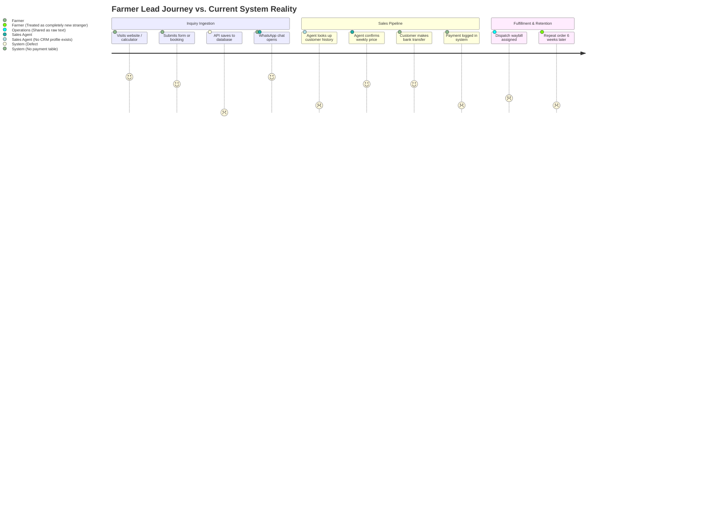

# D-AminGrow — CRM & Enquiry Pipeline Forensic Audit
**Document Ref:** DAG-AUDIT-008  
**Audit Date:** November 3, 2026  
**Scope:** Lead Ingestion, Customer Record Creation, Pipeline Management, and Staff Assignment  
**Database References:** `enquiries`, `enquiry_status_history`, `enquiry_notes`, `staff_profiles`

---

## 1. CRM & Lead Management Architecture Overview

In an agro-allied business where transactions are relationship-driven and prices vary by region and date, customer retention and rapid response times (under 2 hours) determine conversion.

### Core Finding:
The platform **lacks a dedicated Customer entity**. All customer data is treated as ephemeral rows inside the `enquiries` table. A commercial farmer who places 12 chick orders over a year is stored as 12 disconnected inquiry rows with redundant name, phone, and address strings. There is no unified customer profile, no lifetime value calculation, and no automated duplicate detection.

---

## 2. Customer Journey Traceability & Workflow Breakdowns



---

## 3. Forensic Evaluation of CRM Capabilities

### A. Lead Source & Attribution Tracking
- **Schema Provision**: The `enquiries` table in `20261026000001_initial_schema.sql` has columns `utm_source`, `utm_medium`, `utm_campaign`, `ip_address`, and `user_agent`.
- **API Implementation Gap**: [`src/app/api/enquiries/route.ts`](file:///Users/mac/Projects/Damingrow/src/app/api/enquiries/route.ts#L6-L17) **does not accept or parse UTM parameters**.
- **Impact**: Marketing cannot tell whether a high-value 5,000-broiler lead came from an organic Google search on the FCR calculator, a WhatsApp share, or a Facebook campaign.

### B. Inquiry Classification & Routing
The schema defines `enquiry_type_enum`:
1. `whatsapp_order`
2. `bulk_quote`
3. `veterinary_consultation`
4. `farm_setup_inquiry`
5. `general`
- **Gap**: There is no automated routing rule. A critical disease outbreak report (`veterinary_consultation`) enters the exact same general queue as an accessory pricing inquiry.

### C. Staff Assignment & Escalation
- **Schema Provision**: `assigned_to_staff_id UUID REFERENCES staff_profiles(id)`.
- **Implementation Status**: **Zero UI integration**. Sales managers cannot assign specific inquiries to specific veterinary consultants or logistics coordinators.

### D. Communication History & Follow-Up Notes
- **Schema Provision**: The migration defines `enquiry_notes` with `author_staff_id`, `note_text`, and `is_internal`.
- **Implementation Status**: **Completely unused**. There is no API route to create notes and no UI field in the admin inquiry modal to record customer conversations.

### E. Status Lifecycle & Transition History
- **Schema Provision**: `enquiry_status_history` with `previous_status`, `new_status`, `changed_by_staff_id`, and `reason`.
- **Implementation Status**: **Partially simulated in code, unlinked to DB**. In [`src/app/api/admin/enquiries/route.ts`](file:///Users/mac/Projects/Damingrow/src/app/api/admin/enquiries/route.ts), the PATCH handler updates `status` on `enquiries` but does not insert a record into `enquiry_status_history`.

---

## 4. Required CRM Relational Architecture

To eliminate customer fragmentation, D-AminGrow must introduce a dedicated `customers` table in Supabase:

```sql
CREATE TABLE customers (
    id UUID PRIMARY KEY DEFAULT gen_random_uuid(),
    customer_code TEXT NOT NULL UNIQUE, -- e.g. "CUST-08031234567"
    primary_phone TEXT NOT NULL UNIQUE, -- Normalized E.164: +2348031234567
    secondary_phone TEXT,
    email TEXT,
    full_name TEXT NOT NULL,
    farm_name TEXT,
    
    -- Farm Demographics
    primary_state TEXT NOT NULL,
    primary_city TEXT NOT NULL,
    farm_type TEXT[], -- e.g. ['broilers', 'layers']
    estimated_capacity INTEGER, -- e.g. 5000 birds
    
    -- Business Metrics
    total_orders_count INTEGER NOT NULL DEFAULT 0,
    total_cartons_booked INTEGER NOT NULL DEFAULT 0,
    total_spend_ngn NUMERIC(14, 2) NOT NULL DEFAULT 0,
    first_order_date DATE,
    last_order_date DATE,
    customer_tier TEXT NOT NULL DEFAULT 'standard' CHECK (customer_tier IN ('lead', 'standard', 'vip_commercial', 'inactive')),
    
    assigned_account_manager_id UUID REFERENCES staff_profiles(id),
    internal_notes TEXT,
    created_at TIMESTAMPTZ NOT NULL DEFAULT NOW(),
    updated_at TIMESTAMPTZ NOT NULL DEFAULT NOW()
);

-- Foreign Key Link from Enquiries and Chick Bookings to Customers
ALTER TABLE enquiries ADD COLUMN customer_id UUID REFERENCES customers(id) ON DELETE SET NULL;
```

---

## 5. Summary of CRM Defects & Next Steps

1. **Fix Lead Ingestion Schema**: Update `src/app/api/enquiries/route.ts` to capture client UTMs and insert properly formatted rows into `enquiries`.
2. **Build Phone-Based Customer Deduplication**: Before inserting an inquiry, search `customers` by normalized phone number. If found, link `customer_id`; if not, auto-create a new customer profile.
3. **Build Admin Customer 360 View (`/admin/customers/[id]`)**: Show customer contact details, all past chick bookings, drug inquiries, and consultation history on a single screen.
