# D-AminGrow — Day-Old Chick Booking Forensic Audit
**Document Ref:** DAG-AUDIT-005  
**Audit Date:** November 3, 2026  
**Business Priority:** P0 (Core Revenue Engine)  
**Primary Components:** [`src/app/(storefront)/chicks/chick-booking-form.tsx`](file:///Users/mac/Projects/Damingrow/src/app/(storefront)/chicks/chick-booking-form.tsx), [`src/app/(storefront)/chicks/page.tsx`](file:///Users/mac/Projects/Damingrow/src/app/(storefront)/chicks/page.tsx), [`src/app/admin/(dashboard)/chicks-pricing/page.tsx`](file:///Users/mac/Projects/Damingrow/src/app/admin/(dashboard)/chicks-pricing/page.tsx)

---

## 1. Executive Evaluation of the Chick Booking System

Day-old chick booking represents the primary high-volume transaction stream for D-AminGrow. The commercial reality of Nigerian poultry requires:
1. Sourcing from certified parent-stock hatcheries (Zartech, Amo, Chi, Sayed, Agrited).
2. Fixed dispatch schedules: **Nationwide dispatch takes place strictly on Tuesdays and Thursdays**.
3. Packaging standards: **50 chicks plus 1 extra bonus chick per carton** (51 total chicks).
4. Motor park transport logistics: Chicks are conveyed via commercial luxury interstate transit buses to regional motor park depots across all 36 states.
5. Bi-weekly price updates: Hatcheries declare new chick rates every Monday and Thursday morning at 9:00 AM.

### Forensic Finding:
The platform features an **exceptional frontend booking slip generator** with high-converting UX psychology. However, **the backend booking management, allocation tracking, and payment confirmation workflows are non-existent**. All commercial fulfillment currently relies 100% on manual staff WhatsApp conversation handling.

---

## 2. Implemented Capabilities vs Missing Features

| Capability | Current Code Implementation | Operational Reality | Gap Classification |
|---|---|---|---|
| **Breed Selection** | Broilers, Pullets, Turkeys, Noilers, Cockerels selectable in UI | Form populates WhatsApp text | **Frontend Only** |
| **Hatchery Preference** | Amo, Zartech, Chi, Sayed, Agrited selectable | Injected into WhatsApp slip | **Frontend Only** |
| **Quantity Validation** | Step counter increments by 1 carton (51 chicks); defaults to 10 cartons (510 chicks) | Validated in React state | **Frontend Only** |
| **Dispatch Scheduling** | Toggle between Tuesday and Thursday Morning | Injected into WhatsApp message | **Frontend Only** |
| **Destination Routing** | Nigerian state dropdown (36 states) + City input | Passed in WhatsApp payload | **Frontend Only** |
| **Booking Reference** | Generated client-side (`DOC-XXXX-XXX`) | Generated via `Math.random()` | **Frontend Only** |
| **Database Persistence** | POST `/api/enquiries` | **BROKEN**: Fails silently due to column mismatch | **Defect** |
| **Duplicate Submission Guard** | None | Farmer can submit 10 times consecutively | **Missing** |
| **Hatchery Quota Allocation** | None | No system check if Zartech has cartons available | **Missing** |
| **Over-Allocation Prevention** | None | Risk of taking deposits for sold-out hatch dates | **Missing** |
| **Deposit / Payment Tracking** | None | Payments verified informally via bank transfer screenshots in WhatsApp | **Missing** |
| **Admin Booking Calendar** | None | Admin has no visual calendar of Tuesday/Thursday orders | **Missing** |
| **Motor Park Waybill Tracking**| None | Waybill numbers shared as raw text in WhatsApp | **Missing** |

---

## 3. End-to-End Booking Lifecycle Trace

```mermaid
stateDiagram-v2
    [*] --> FarmerBookingForm: Visits /chicks
    FarmerBookingForm --> WhatsAppInitiation: Generates DOC-XXXX reference
    WhatsAppInitiation --> DatabaseSilentFailure: POST /api/enquiries (Fails 42703)
    WhatsAppInitiation --> WhatsAppConversation: Opens wa.me chat with sales desk
    
    state "Manual WhatsApp Handling (Unsystematized)" as WhatsAppManual {
        WhatsAppConversation --> PriceQuotation: Sales agent checks Monday/Thursday hatchery price sheet
        PriceQuotation --> BankDetailsProvided: Sales agent shares company account details
        BankDetailsProvided --> ProofOfPayment: Customer sends screenshot of bank transfer
        ProofOfPayment --> ManualHatcherySlotReservation: Sales agent calls hatchery coordinator
        ManualHatcherySlotReservation --> WaybillIssued: Hatchery dispatches; motor park waybill issued
        WaybillIssued --> CustomerPickup: Customer collects at regional bus depot
    }

    CustomerPickup --> [*]
```



### Critical Risks in Current Booking Workflow
1. **Zero Centralised Record**: If the sales phone is misplaced, damaged, or staff change, all active Tuesday/Thursday bookings, customer contact details, and payment statuses are permanently lost.
2. **Double Booking & Over-Allocation**: During peak seasons (e.g. October–December Christmas broiler cycle), hatcheries cap carton allocations. Without a real-time carton counter, sales agents can accept bookings for cartons that cannot be fulfilled.
3. **Price Discrepancy Window**: If a customer fills the booking form on Sunday evening at Friday's price, but hatcheries increase prices on Monday at 9:00 AM, there is no automated notification of rate changes.

---

## 4. Required Database Architecture for Chick Bookings

To transition D-AminGrow into an enterprise-grade platform, the following dedicated schema must be created in Supabase:

### Required Table: `chick_bookings`
```sql
CREATE TYPE chick_breed_enum AS ENUM (
    'broiler_cobb500', 
    'broiler_arbor_acres', 
    'layer_isa_brown', 
    'layer_lohmann', 
    'turkey_hybrid', 
    'noiler_hybrid', 
    'cockerel_white'
);

CREATE TYPE booking_status_enum AS ENUM (
    'inquiry_received',       -- Customer submitted form
    'rate_quoted',            -- Current weekly price confirmed to customer
    'deposit_pending',        -- Bank details issued
    'payment_verified',       -- Finance verified transfer
    'hatchery_confirmed',     -- Allocation secured with hatchery
    'dispatched_in_transit',  -- Waybill issued; bus departed
    'delivered_collected',    -- Customer picked up at motor park
    'cancelled_refunded'      -- Order cancelled
);

CREATE TABLE chick_bookings (
    id UUID PRIMARY KEY DEFAULT gen_random_uuid(),
    booking_ref TEXT NOT NULL UNIQUE, -- e.g. "DOC-20261103-882"
    customer_name TEXT NOT NULL,
    customer_phone TEXT NOT NULL,
    customer_email TEXT,
    farm_name TEXT,
    
    -- Booking Specifications
    breed chick_breed_enum NOT NULL,
    preferred_hatchery TEXT NOT NULL, -- e.g. "Zartech", "Amo", "Chi"
    carton_count INTEGER NOT NULL CHECK (carton_count >= 1),
    chicks_per_carton INTEGER NOT NULL DEFAULT 51,
    total_chicks_estimated INTEGER GENERATED ALWAYS AS (carton_count * chicks_per_carton) STORED,
    
    -- Dispatch Logistics
    dispatch_date DATE NOT NULL, -- Must be a Tuesday or Thursday
    destination_state TEXT NOT NULL,
    destination_city TEXT NOT NULL,
    destination_motor_park TEXT,
    waybill_number TEXT,
    driver_phone TEXT,
    
    -- Financials
    quoted_price_per_carton NUMERIC(10, 2),
    total_quoted_amount NUMERIC(12, 2),
    deposit_amount_paid NUMERIC(12, 2) DEFAULT 0,
    payment_reference TEXT,
    
    -- State Management
    status booking_status_enum NOT NULL DEFAULT 'inquiry_received',
    assigned_staff_id UUID REFERENCES staff_profiles(id),
    internal_notes TEXT,
    
    created_at TIMESTAMPTZ NOT NULL DEFAULT NOW(),
    updated_at TIMESTAMPTZ NOT NULL DEFAULT NOW()
);
```

---

## 5. Required Administrative Interface Additions

1. **Interactive Booking Calendar (`/admin/bookings/calendar`)**:
   - Visual monthly/weekly calendar highlighting every **Tuesday** and **Thursday** dispatch day.
   - Shows booked cartons vs. available hatchery quotas (e.g. "Tuesday, Nov 10: 140 / 200 Cartons Booked").
   - Filterable by hatchery (Amo, Zartech, Chi).
2. **Booking Allocation & Status Pipeline (`/admin/bookings`)**:
   - Kanban / table view of all chick orders moving from `inquiry_received` -> `payment_verified` -> `dispatched`.
   - Single-click action to generate customer WhatsApp waybill SMS notification.
