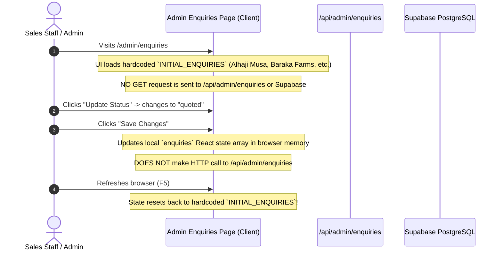

# D-AminGrow — Frontend to Backend Traceability Audit
**Document Ref:** DAG-AUDIT-003  
**Audit Date:** November 3, 2026  
**Objective:** Trace every customer interaction point from UI component down to API endpoint, database table, and external integration.

---

## 1. Traceability Matrix Overview

| Frontend Feature & Component | Trigger Event | Target Endpoint / Handler | Target DB Table / Service | Actual Data State | Verified Status |
|---|---|---|---|---|---|
| **Chick Booking Form** (`chick-booking-form.tsx`) | "Book Chicks via WhatsApp" submit | `fetch('/api/enquiries', POST)` + `window.open(wa.me)` | `enquiries` table in Supabase | Fails silently on DB insert; opens WhatsApp | **Implemented but Broken** |
| **Inquiry Bag / Cart Drawer** (`cart-drawer.tsx`) | "Submit Inquiry for Today's Price" submit | `fetch('/api/enquiries', POST)` + `window.open(wa.me)` | `enquiries` table in Supabase | Fails silently on DB insert; opens WhatsApp | **Implemented but Broken** |
| **Contact Form** (`contact/page.tsx`) | "Send Inquiry" form submit | `fetch('/api/enquiries', POST)` | `enquiries` table in Supabase | Fails silently on DB insert; displays success | **Implemented but Broken** |
| **Services Consultation Form** (`services/page.tsx`) | "Request Consultation" submit | `fetch('/api/enquiries', POST)` + `window.open(wa.me)` | `enquiries` table in Supabase | Fails silently on DB insert; opens WhatsApp | **Implemented but Broken** |
| **Single Product Inquiry** (`product-card.tsx`) | "Ask Price" button click | None (Direct client action) | Direct WhatsApp URL generation | Client-side only; no backend trace | **Frontend Only** |
| **Single Product In-Depth Inquiry** (`product-client-actions.tsx`) | "Request Current Price" click | None (Direct client action) | Direct WhatsApp URL generation | Client-side only; no backend trace | **Frontend Only** |
| **Admin Chick Pricing Sync** (`chicks-pricing/page.tsx`) | "Publish New Chick Rates" submit | `fetch('/api/admin/chicks-pricing', POST)` | `audit_events` in Supabase | Writes to `audit_events`; does not update products | **Implemented but Incomplete** |
| **Admin Inquiry Status Update** (`enquiries/page.tsx`) | Modal "Save Status" submit | `useState` in React (Local client memory) | None (`/api/admin/enquiries` exists but is not called) | State lost on browser refresh | **Implemented but Broken** |
| **Admin Login Form** (`admin/login/page.tsx`) | "Sign In" button submit | `supabase.auth.signInWithPassword()` | Supabase Auth (`auth.users`) | Successfully logs in and sets auth cookies | **Fully Implemented and Verified** |
| **All Farm Calculators** (`calculators/*`) | Slider / input value adjustments | Client-side React state & math equations | None (Local calculation engine) | Pure client-side calculations + optional WhatsApp dispatch | **Fully Implemented and Verified** |

---

## 2. In-Depth Trace: Day-Old Chick Booking Workflow

```mermaid
sequenceDiagram
    autonumber
    actor Farmer as Nigerian Farmer
    participant Form as ChickBookingForm (Client)
    participant API as /api/enquiries (Next.js)
    participant DB as Supabase PostgreSQL
    participant WA as WhatsApp API (+2348139169402)

    Farmer->>Form: Selects Breed, Hatchery, Cartons, State, City, Dispatch Day
    Farmer->>Form: Clicks "Book Chicks via WhatsApp"
    Form->>Form: Generates Reference `DOC-XXXX-XXX`
    Form->>API: POST /api/enquiries with JSON payload
    Note over Form,API: Payload packs details into a single unstructured `notes` string
    API->>DB: INSERT into `enquiries` (reference_number, consent_given)
    Note over API,DB: CRITICAL DEFECT: Columns `reference_number` and `consent_given` do not exist!
    DB-->>API: ERROR: 42703 (Undefined column)
    Note over API: Error caught in try/catch; logged to console.error; swallowed
    API-->>Form: 200 OK { success: true, referenceNumber: "..." }
    Form->>WA: window.open("https://wa.me/2348139169402?text=...")
    Note over Farmer,WA: WhatsApp chat opens with pre-filled booking slip
    Note over DB: ZERO records stored in database!
```

### Forensic Defect Breakdown
- **File:** [`src/app/api/enquiries/route.ts`](file:///Users/mac/Projects/Damingrow/src/app/api/enquiries/route.ts#L32-L44)
- **Code:**
  ```typescript
  await supabase.from('enquiries').insert({
    reference_number: referenceNumber, // <--- Bug 1: Column in DB is `enquiry_ref`
    enquiry_type: validated.enquiryType,
    customer_name: validated.fullName,
    customer_phone: validated.phone,
    farm_name: validated.farmName || null,
    delivery_state: validated.state,
    delivery_city: validated.city || validated.state,
    user_notes: validated.notes || null,
    consent_given: validated.consentMarketing, // <--- Bug 2: Column does not exist on enquiries
    status: 'pending_contact',
  });
  ```
- **Consequence:** D-AminGrow has no persistent audit record of chick booking volumes, customer contact details, or repeat orders in their database. All operational data exists solely inside staff WhatsApp chat histories.

---

## 3. In-Depth Trace: Admin Enquiries Management



### Forensic Defect Breakdown
- **File:** [`src/app/admin/(dashboard)/enquiries/page.tsx`](file:///Users/mac/Projects/Damingrow/src/app/admin/(dashboard)/enquiries/page.tsx#L91)
- **Code:**
  ```typescript
  const [enquiries, setEnquiries] = useState<EnquiryRecord[]>(INITIAL_ENQUIRIES);
  ```
- **Endpoint Exists But Is Disconnected:** [`src/app/api/admin/enquiries/route.ts`](file:///Users/mac/Projects/Damingrow/src/app/api/admin/enquiries/route.ts) has a `PATCH` handler implemented, but it is never called by the admin UI component, has no `GET` method to fetch data, and lacks session authentication guards.

---

## 4. In-Depth Trace: Admin Chick Price Synchronisation

- **File:** [`src/app/admin/(dashboard)/chicks-pricing/page.tsx`](file:///Users/mac/Projects/Damingrow/src/app/admin/(dashboard)/chicks-pricing/page.tsx#L91-L105)
- **Action:** Submits POST to `/api/admin/chicks-pricing`.
- **Backend Handler:** [`src/app/api/admin/chicks-pricing/route.ts`](file:///Users/mac/Projects/Damingrow/src/app/api/admin/chicks-pricing/route.ts#L29-L39).
- **Behavior:**
  - Validates input with Zod (`priceSyncSchema`).
  - Inserts an audit event into `audit_events`.
  - **Does NOT update any product or variant pricing table**.
  - Since storefront products are hardcoded in `src/data/products.ts`, even if the database were updated, storefront prices would remain unchanged unless the code file is edited and redeployed.

---

## 5. Traceability Summary Matrix

| Capability | Frontend Implementation | API Route | Database Persistence | Real-World Operational Readiness |
|---|---|---|---|---|
| **Submit Customer Contact** | 100% Complete | Present | Broken (Schema mismatch) | **30% Operational** (WhatsApp fallback only) |
| **Book Day-Old Chicks** | 100% Complete | Present | Broken (Schema mismatch) | **40% Operational** (WhatsApp fallback only) |
| **View Inquiries in Admin** | 100% Complete (UI) | Missing GET | Disconnected (Mock array) | **10% Operational** (Demo mode only) |
| **Manage Pricing from Admin** | 90% Complete (UI) | Present POST | Incomplete (Audit only) | **20% Operational** (Does not alter catalog) |
| **Staff Authentication** | 100% Complete | Native Supabase | Working (`staff_profiles`) | **85% Operational** (Middleware bypass needs removal) |
| **Farm Planning Calculators** | 100% Complete | N/A (Client Math) | Optional WhatsApp share | **100% Operational** (Self-contained) |
