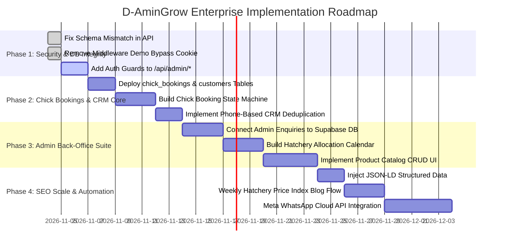

# D-AminGrow — Phased Implementation Roadmap
**Document Ref:** DAG-AUDIT-016  
**Audit Date:** November 3, 2026  
**Guiding Principle:** Non-Destructive Evolutionary Implementation (Zero Disruption to Existing Working Features)

---

## 1. Roadmap Overview & Timeline

---

## 2. Phase 1: Security Hardening & Database Integrity (Days 1–3, Priority: P0)

### Objectives
Eliminate all critical authentication bypass vulnerabilities and fix the schema mismatch preventing inquiry persistence.

### Action Items
1. **Remove Middleware Auth Bypass**:
   - Delete `damingrow_staff_demo` cookie logic in `src/lib/supabase/middleware.ts`.
   - Ensure `/admin/*` redirects to `/admin/login` across all environments when no valid Supabase user exists.
2. **Harden Admin API Routes**:
   - Update `src/app/api/admin/enquiries/route.ts` and `src/app/api/admin/chicks-pricing/route.ts` to verify `supabase.auth.getUser()` and check role membership in `staff_profiles`.
3. **Fix Inquiry Ingestion Schema Mismatch**:
   - Update `src/app/api/enquiries/route.ts` line 33 to insert into `enquiry_ref` (instead of `reference_number`).
   - Store marketing consent into the related `consent_records` table.
   - Map line items into the `items` JSONB column.

### Acceptance Criteria
- [ ] Submitting the contact form or chick booking form successfully creates a record in Supabase `enquiries`.
- [ ] Visiting `/admin` without signing in redirects to `/admin/login` even if `damingrow_staff_demo` cookie is present.
- [ ] Direct `PATCH` requests to `/api/admin/enquiries` without a valid staff bearer token return `401 Unauthorized`.

---

## 3. Phase 2: Live Chick Booking & Customer CRM Core (Days 4–10, Priority: P1)

### Objectives
Systematize D-AminGrow's primary revenue engine: Tuesday & Thursday chick dispatch bookings and repeat customer aggregation.

### Action Items
1. **Execute Supabase Migration (`20261107000001_chick_bookings_and_customers.sql`)**:
   - Create `customers` table with phone index (`primary_phone`).
   - Create `chick_bookings` table with breed enums, carton step counts, and dispatch dates.
2. **Update Chick Booking Form**:
   - Connect `src/app/(storefront)/chicks/chick-booking-form.tsx` to a new endpoint `POST /api/bookings/chicks`.
   - Return an official booking ticket with guaranteed reference and automated payment instructions.
3. **Automated Phone Deduplication**:
   - When a booking arrives, search `customers` by phone. Link to existing customer or create a new profile automatically.

### Acceptance Criteria
- [ ] A farmer reserving 10 cartons of Zartech broilers receives an immediate booking confirmation and a database row is created.
- [ ] Repeat orders from the same telephone number automatically link to the customer's historical profile.

---

## 4. Phase 3: Admin Back-Office & Allocation Suite (Days 11–21, Priority: P1/P2)

### Objectives
Replace mock administrative arrays with real-time operational interfaces for sales agents and managers.

### Action Items
1. **Live Enquiries View (`/admin/enquiries`)**:
   - Replace `INITIAL_ENQUIRIES` with a real-time query against the `enquiries` table.
   - Implement live status updates (`quoted`, `fulfilled`) that persist to Supabase.
2. **Hatchery Dispatch Calendar (`/admin/chicks/calendar`)**:
   - Build a monthly/weekly calendar view highlighting Tuesday and Thursday dispatches.
   - Show booked cartons vs. available hatchery quotas with color-coded warning thresholds.
3. **Product Catalog CRUD Manager (`/admin/products`)**:
   - Implement Add/Edit modals with image uploads to Supabase Storage bucket `product-media`.

### Acceptance Criteria
- [ ] Staff can view incoming live inquiries within 2 seconds of customer submission.
- [ ] Staff can view Tuesday's total carton commitments across Zartech, Amo, and Chi in a visual calendar.

---

## 5. Phase 4: SEO Scale, Authority & Automation (Days 22–35, Priority: P2/P3)

### Objectives
Scale organic search traffic to 500,000+ monthly visits and streamline customer communication.

### Action Items
1. **Inject Schema.org JSON-LD**:
   - Add `Product`, `MedicalWebPage`, `LocalBusiness`, and `BreadcrumbList` microdata.
2. **Weekly Hatchery Price Trend Analysis**:
   - Establish an editorial workflow publishing weekly Monday morning market rate analyses.
3. **Downloadable PDF Lead Magnets**:
   - Create downloadable PDF vaccination schedules and brooding manuals to capture farmer emails and phone numbers.
4. **Meta WhatsApp Cloud API Integration**:
   - Automate dispatch notifications (sending waybill numbers and bus driver phone numbers directly to customer WhatsApp).
