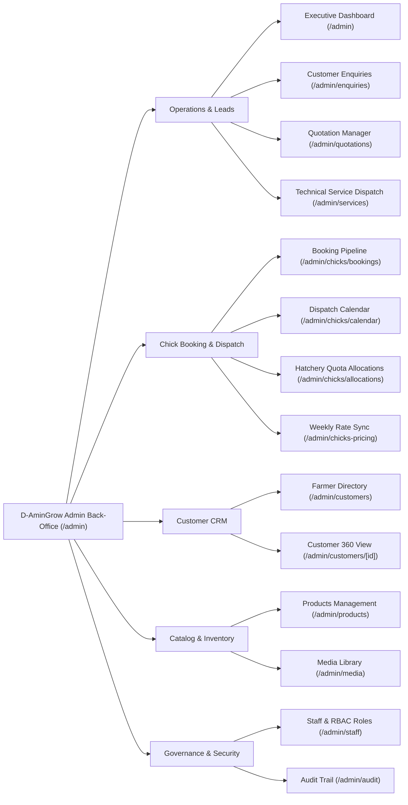
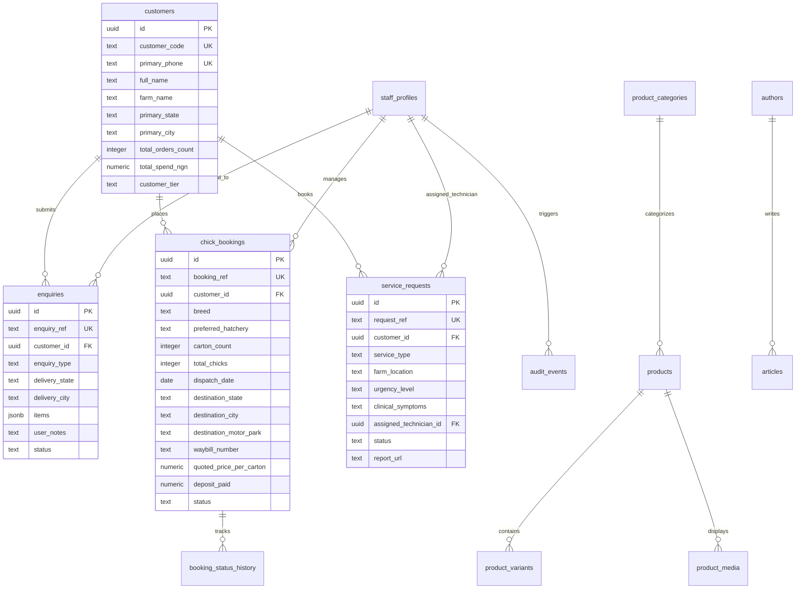

# D-AminGrow — Target Information & Entity Architecture
**Document Ref:** DAG-AUDIT-015  
**Audit Date:** November 3, 2026  
**Objective:** Define the enterprise information hierarchy, administrative navigation, and relational database model to scale D-AminGrow to 500,000 monthly visitors.

---

## 1. Storefront Information Architecture

```mermaid
graph TD
    Root["D-AminGrow Storefront (damingrow.com)"]
    
    Root --> Products["Products Hub (Price on Request)"]
    Products --> DOC["Day-Old Chicks (/chicks)"]
    Products --> POL["Point-of-Lay Birds (/point-of-lay)"]
    Products --> Drugs["Veterinary Drugs (/drugs)"]
    Products --> Vac["Livestock Vaccines (/vaccines)"]
    Products --> Acc["Housing & Equipment (/accessories)"]
    Products --> PDP["Product Detail Pages (/[category]/[slug])"]

    Root --> Services["Services Funnels (/services)"]
    Services --> S_Tech["Technical Services (/services/technical)"]
    Services --> S_Cons["Farm Consultation (/services/consultation)"]
    Services --> S_DOC["Chick Booking Service (/services/chicks)"]
    Services --> S_Vac["Vaccine Distribution (/services/vaccines)"]
    Services --> S_Drugs["Veterinary Drugs (/services/drugs)"]
    Services --> S_POL["Point-of-Lay Sales (/services/point-of-lay)"]

    Root --> Calculators["Farm Decision Suite (/calculators)"]
    Calculators --> Calc_Brood["Brooder Space Calculator (/calculators/brooder)"]
    Calculators --> Calc_Vac["Vaccination Timetable Generator (/calculators/vaccination)"]
    Calculators --> Calc_FCR["FCR & Feed Margin Calculator (/calculators/fcr)"]
    Calculators --> Calc_HDP["Hen-Day Egg Production Tool (/calculators/egg-production)"]
    Calculators --> Calc_Symp["Disease Symptom Triager (/calculators/symptom-checker)"]

    Root --> Knowledge["Knowledge Centre (/knowledge)"]
    Knowledge --> Articles["12+ Clinical Guides (/knowledge/[slug])"]
    Knowledge --> Authors["Expert Veterinarians (/authors/[slug])"]

    Root --> Company["Company & Legal"]
    Company --> About["About D-AminGrow (/about)"]
    Company --> Contact["Contact & Regional Depots (/contact)"]
    Company --> Policies["Terms, Privacy, Shipping (/policies/*)"]
```

---

## 2. Target Administrative Back-Office Navigation

---

## 3. Relational Entity-Relationship Model (Target ERD)

