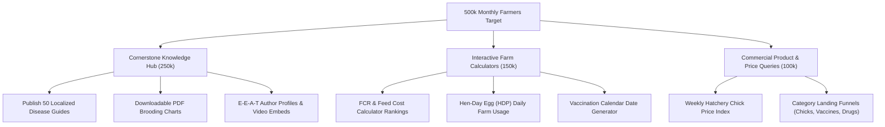

# D-AminGrow — Technical SEO & Content Architecture Audit
**Document Ref:** DAG-AUDIT-009  
**Audit Date:** November 3, 2026  
**Strategic Target:** 500,000+ Monthly Organic Visits across Nigeria and West Africa  
**Current Indexed Coverage:** 78 Static & SSG Routes (`sitemap.xml`)

---

## 1. Executive Evaluation: SEO Foundation & Growth Engine

D-AminGrow has an **exceptionally strong technical SEO architecture** built natively into the Next.js 15 App Router. Pages feature server-side rendering (SSG), pre-rendered metadata, dynamic sitemaps, semantic HTML, and localized search keywords tailored to Nigerian agriculture (e.g., "Day-old chicks price Nigeria", "Coccidiosis treatment broilers", "FCR poultry calculator", "Point-of-lay pullets Ibadan Lagos").

### Key SEO Metrics
- **Dynamic XML Sitemap:** Fully functional at `/sitemap.xml` generated via [`src/app/sitemap.ts`](file:///Users/mac/Projects/Damingrow/src/app/sitemap.ts). Automatically indexes all 28 products, 12 articles, 5 calculators, and 7 service funnels.
- **Search Engine Directives:** Clean `/robots.txt` generated via [`src/app/robots.ts`](file:///Users/mac/Projects/Damingrow/src/app/robots.ts). Directs crawlers to the sitemap and blocks private `/admin/` and `/api/` paths.
- **OpenGraph & Social Sharing:** Pre-configured across all routes with titles, descriptions, and metadataBase set to `https://damingrow.com`.

---

## 2. Technical SEO Checklist & Findings

| Audit Dimension | Standard Expected | Current Codebase Implementation | Status |
|---|---|---|---|
| **Title Tags** | Unique, keyword-rich, under 60 chars | Every page exports a unique Next.js `metadata.title` with "D-AminGrow Nigeria" brand suffix | **PASS** |
| **Meta Descriptions** | High-intent, actionable, 120–160 chars | Exported via `metadata.description` on all routes | **PASS** |
| **Canonical URLs** | Canonical link tags on all pages | Set via `metadataBase: new URL('https://damingrow.com')` | **PASS** |
| **Robots Directives** | Disallow admin and internal APIs | `/admin/*` and `/api/*` disallowed in `src/app/robots.ts` | **PASS** |
| **Sitemap Completeness** | All public pages indexed | All 78 URLs included with priorities (0.5 to 1.0) | **PASS** |
| **Heading Hierarchy** | Single `<h1>` per page, sequential `<h2>`/`<h3>` | Verified across homepage, product, service, and article templates | **PASS** |
| **Image Optimization** | `next/image` with WebP/AVIF and `alt` tags | All catalog cards and article hero images use `next/image` with descriptive `alt` text | **PASS** |
| **JSON-LD Schema Markup** | Rich snippets for Google search | **MISSING**: No Schema.org `Organization`, `LocalBusiness`, `Product`, or `Article` JSON-LD | **DEFECT** |
| **Breadcrumb Schema** | Hierarchical navigation snippets | Breadcrumb UI exists, but lacks `BreadcrumbList` JSON-LD microdata | **GAP** |

---

## 3. Educational Knowledge Hub & E-E-A-T Content Analysis

The Knowledge Centre (`/knowledge` and `/knowledge/[slug]`) contains **12 comprehensive cornerstone agricultural guides** in [`src/data/articles.ts`](file:///Users/mac/Projects/Damingrow/src/data/articles.ts):

| Article Slug | Category | Reading Time | Target Keyword Intent |
|---|---|---|---|
| `poultry-vaccination-schedule-nigeria` | Health & Disease | 10 mins | "Poultry vaccination timetable Nigeria Lasota Gumboro" |
| `how-to-treat-coccidiosis-poultry` | Health & Disease | 8 mins | "Coccidiosis treatment broiler bloody stool Amprolium" |
| `day-old-chick-brooding-guide` | Brooding & Rearing | 12 mins | "Day old chicks brooding temperature first week guide" |
| `how-to-calculate-fcr-broiler-poultry-feed-costs-nigeria` | Farm Management | 9 mins | "How to calculate FCR broiler poultry feed cost Nigeria" |
| `point-of-lay-pullet-management-egg-production-nigeria` | Layer Production | 11 mins | "Point of lay pullet feeding egg production Nigeria" |
| `poultry-biosecurity-checklist-farm-disinfection-nigeria` | Farm Management | 8 mins | "Poultry biosecurity checklist farm disinfection Nigeria" |
| `broiler-heat-stress-management-tropical-climate-nigeria` | Environmental Control | 9 mins | "Broiler heat stress open sided pens Nigeria" |
| `day-old-chick-hatchery-booking-guide-nigeria` | Sourcing & Logistics | 7 mins | "Day old chick booking hatchery price Zartech Amo Chi" |
| `layer-battery-cage-vs-deep-litter-nigeria` | Housing & Equipment | 10 mins | "Battery cage vs deep litter poultry farm cost Nigeria" |
| `poultry-water-quality-testing-sanitation-nigeria` | Biosecurity & Health | 8 mins | "Poultry borehole water sanitation chlorine acidifier" |
| `feed-formulation-reducing-poultry-feed-costs-nigeria` | Nutrition & Feed | 12 mins | "Feed formulation broiler layer reducing feed cost Nigeria" |
| `poultry-farm-record-keeping-templates-nigeria` | Business Planning | 7 mins | "Poultry farm daily mortality egg production records" |

### E-E-A-T (Experience, Expertise, Authoritativeness, Trustworthiness) Assessment:
- **Strengths**: Articles contain clinical depth, precise drug dosages (e.g. Amprolium 200mg/g, Sulfaquinoxaline, Lasota 1,000 doses), temperature ranges (32°C–35°C), and local trade realities.
- **Critical Gaps**:
  1. *Author Credentials*: Articles list static string author names (`"Dr. Olumide Adeleke, DVM"`, `"Engr. Babatunde Lawal"`), but have no dedicated author bio pages (`/author/[slug]`) or verified veterinary license credentials.
  2. *Reviewed-By Attribution*: Google's Medical and Life-Safety (YMYL - Your Money or Your Life) guidelines require visible "Medically Reviewed By" badges with dates for veterinary drug dosage guides.
  3. *Zero Schema.org Article Markup*: No `MedicalWebPage` or `TechArticle` structured data is injected into HTML.

---

## 4. Strategic Blueprint to Reach 500,000 Monthly Farmer Visits

To grow from current baseline to 500k monthly visits across Nigeria, Ghana, Kenya, and West Africa:

### Actionable Implementation Steps:
1. **Inject Schema.org JSON-LD**: Add dynamic structured data to `src/app/(storefront)/knowledge/[slug]/page.tsx` and `src/app/(storefront)/[category]/[slug]/page.tsx`.
2. **Weekly Hatchery Price Trend Blog Post**: Publish an authoritative weekly price analysis every Monday morning ("Chick Prices for Week 45: Broiler & Pullet Rates Across Zartech, Amo, Chi"). This alone can capture 50k+ high-intent searchers weekly in Nigeria.
3. **Downloadable PDF Guides**: Add one-click PDF downloads of the "Comprehensive Nigerian Poultry Vaccination Timetable" requiring customer phone/email for lead capture.
