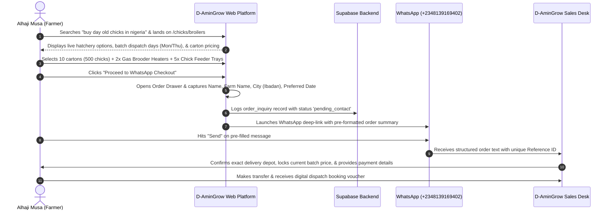
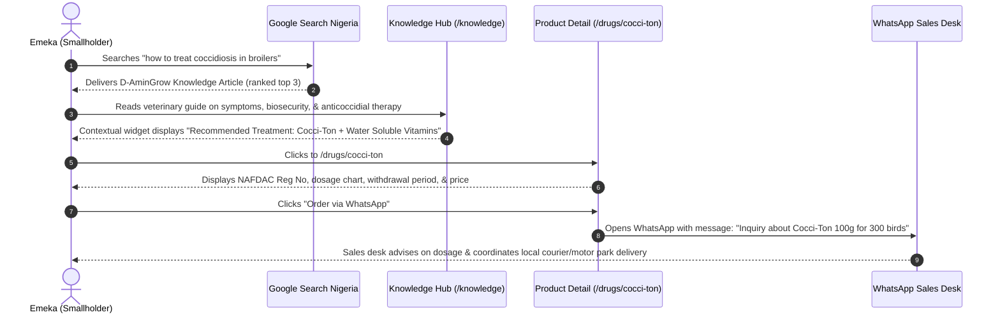
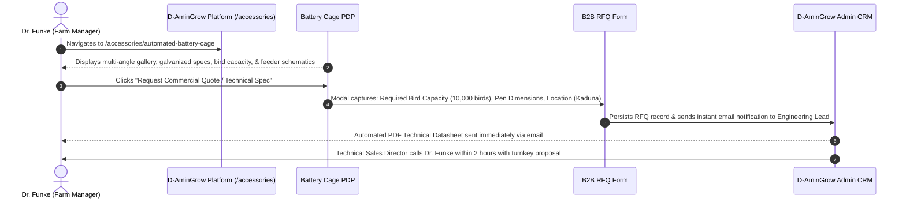

# D-AminGrow — User Journeys & Conversion Rate Optimization (CRO)
**Document Ref:** DAG-DISC-004  
**Version:** 1.0.0  
**Research Date:** 2026-10-26  
**Auditor:** UX/UI Director & Digital Growth Researcher  
**Status:** Completed & Validated  

---

## 1. Customer Personas (Target Audience Segmentation)

To design high-converting, friction-free customer journeys, we model D-AminGrow's audience into four primary behavioral personas:

### Persona 1: Alhaji Musa — Commercial Broiler Farmer
- **Demographics:** 48 years old, operates a 5,000-bird commercial broiler farm outside Ibadan, Oyo State.
- **Device & Habits:** Mid-range Android smartphone (Samsung A-series) on MTN 4G network; conducts 95% of business via WhatsApp and voice calls.
- **Pain Points:** Unreliable chick hatcheries delivering weak day-old chicks, sudden chick mortality during brooding, fluctuating bird market prices, fear of counterfeit veterinary drugs.
- **Primary Need:** Scheduled weekly bookings for vigorous, vaccinated day-old broiler chicks, reliable gas brooders, and rapid delivery.
- **Conversion Trigger:** Hatchery brand transparency (Amo, Zartech), clear delivery hub options, direct WhatsApp relationship with an expert sales agent.

---

### Persona 2: Emeka — Emerging Smallholder Poultry Farmer
- **Demographics:** 29 years old, runs a 300-bird backyard layer flock in Ogun State while maintaining a day job.
- **Device & Habits:** Uses a budget Android device (Infinix/Tecno) with intermittent 3G/4G connectivity; highly cost-conscious.
- **Pain Points:** Lack of formal veterinary knowledge, high panic when chicks display respiratory distress or bloody stools, easily misled by local roadside agro-vet shops.
- **Primary Need:** Affordable manual drinkers/feeders, accurate diagnostic guidance, small-quantity medication packs (e.g. 100g Ascorbic Acid, Cocci-Ton).
- **Conversion Trigger:** Clear dosage instructions on product detail pages, educational articles linking diseases directly to treatments, low minimum order thresholds.

---

### Persona 3: Dr. Funke — Corporate Farm Manager & Veterinarian
- **Demographics:** 37 years old, manages a corporate integrated poultry operation (50,000 layers) in Kaduna / Abuja corridor.
- **Device & Habits:** Uses iPhone 14 and MacBook Air on fiber office internet and 5G; demands technical specification sheets, VAT receipts, and NAFDAC documentation.
- **Pain Points:** Supply chain bottlenecks, cold-chain failure during vaccine transit, poor durability of cheap imported poultry battery cages.
- **Primary Need:** Wholesale commercial equipment (Automated Tiered Battery Cages, Stainless Defeathering Machines), certified vaccines with verifiable cold-chain transit, bulk pricing.
- **Conversion Trigger:** Downloadable technical spec sheets, verified NAFDAC registration numbers, corporate B2B quotation workflows.

---

### Persona 4: Tunde — Diaspora Agricultural Investor
- **Demographics:** 42 years old, Nigerian software engineer living in the United Kingdom, investing in a new 10-hectare automated livestock farm in Osun State.
- **Device & Habits:** Uses high-end desktop and iOS; expects seamless modern UI, rapid response, and transparent professional accountability.
- **Pain Points:** Difficulty finding trustworthy farm builders in Nigeria; fear of being defrauded by dishonest contractors and untrained farm managers.
- **Primary Need:** Turnkey farm setup consultation, pen construction blueprints, complete biosecurity design, ongoing technical oversight.
- **Conversion Trigger:** Professional corporate design (Poppins/Inter typography), transparent consulting packages, verifiable credentials, and direct consultation booking forms.

---

## 4 End-to-End User Journeys

---

### Journey 1: Commercial Broiler Farmer Ordering Day-Old Chicks & Brooding Kit



---

### Journey 2: Smallholder Diagnosing Disease & Purchasing Veterinary Treatment



---

### Journey 3: Corporate Farm Manager Procuring Capital Equipment (Battery Cages)



---

### Journey 4: Diaspora Investor Seeking Turnkey Farm Setup Consultation

```mermaid
sequenceDiagram
    autonumber
    actor Investor as Tunde (Diaspora Investor)
    participant Web as D-AminGrow Storefront
    participant Services as /services/poultry-farm-consultation
    participant Booking as Consultation Intake Form
    participant Calendar as Veterinary Director Desk

    Investor->>Web: Lands on homepage, impressed by modern Poppins/Inter UI & professional branding
    Investor->>Services: Reads "Commercial Farm Planning & Turnkey Construction Advisory"
    Services-->>Investor: Showcases advisory scope, biosecurity design, and financial feasibility modeling
    Investor->>Booking: Completes intake: Farm Site Size (10 Hectares), Budget Range, Zoom Call Availability
    Booking->>Calendar: Schedules preliminary Zoom consultation & sends calendar invitation
    Calendar-->>Investor: Professional consultation conducted; conversion into paid feasibility study
```

---

## 3. WhatsApp Deep-Link Message Architecture & Encoding

To ensure zero technical failures across mobile devices, browsers, and WhatsApp client versions, WhatsApp deep-links must adhere to strict formatting standards:

### Deep-Link Generation Formula:
```typescript
const BASE_URL = "https://wa.me/2348139169402";

interface OrderPayload {
  orderRef: string;
  customerName: string;
  farmName?: string;
  deliveryCity: string;
  items: Array<{ name: string; quantity: number; unitPrice?: number }>;
  estimatedTotal?: number;
  userNotes?: string;
}

export function generateWhatsAppOrderLink(payload: OrderPayload): string {
  const lines: string[] = [
    `*NEW ORDER INQUIRY — D-AMINGROW*`,
    `*Ref:* ${payload.orderRef}`,
    `*Customer:* ${payload.customerName}${payload.farmName ? ` (${payload.farmName})` : ''}`,
    `*Delivery Location:* ${payload.deliveryCity}`,
    ``,
    `*ITEMS REQUESTED:*`,
    ...payload.items.map(
      (item) => `• ${item.quantity}x ${item.name}${item.unitPrice ? ` — ₦${(item.quantity * item.unitPrice).toLocaleString()}` : ''}`
    ),
    ``,
    payload.estimatedTotal ? `*ESTIMATED SUBTOTAL:* ₦${payload.estimatedTotal.toLocaleString()}` : `*PRICING:* Please confirm today's market rates`,
    ``,
    payload.userNotes ? `*Notes:* ${payload.userNotes}` : `*Notes:* Please confirm batch availability and delivery logistics.`
  ];

  const fullText = lines.join('\n');
  return `${BASE_URL}?text=${encodeURIComponent(fullText)}`;
}
```

---

## 4. Mobile UX Wireframe & Conversion Optimization Hierarchy

Given that 85%+ of Nigerian web traffic originates from mobile smartphones, the interface hierarchy must follow strict mobile-first design principles:

```text
+------------------------------------------+
|  [D-AminGrow Logo]           [Cart (3)]  |
|  "Your Satisfaction Is Our Priority"     |
+------------------------------------------+
|  [Search: "brooder", "vaccines", "cages"]|
+------------------------------------------+
|  CATEGORY QUICK PILLS:                   |
|  [ Chicks ]  [ Drugs ]  [ Vaccines ] ... |
+------------------------------------------+
|  FEATURED PROMOTION BANNER:              |
|  "Book Next Week's Broiler Chicks Early" |
|  [ Reserve Batch Now -> ]                |
+------------------------------------------+
|  PRODUCT CARD GRID (2 Columns):          |
|  +-------------------+ +----------------+|
|  | [Image]           | | [Image]        ||
|  | Gas Brooder Heater| | Cocci-Ton 100g ||
|  | ₦[Price]          | | ₦[Price]       ||
|  | [Quick Add +]     | | [Quick Add +]  ||
|  +-------------------+ +----------------+|
+------------------------------------------+
|  TRUST BAR:                              |
|  [✓ NAFDAC Reg] [✓ Cold-Chain Guaranteed]|
+------------------------------------------+
|  PERSISTENT FLOATING STICKY BOTTOM BAR:  |
|  [ View Cart / 3 Items: ₦48,500 ]        |
|  [ >> CHAT & ORDER ON WHATSAPP << ]      |
+------------------------------------------+
```

### Key Friction Eliminators on Mobile:
1. **Persistent WhatsApp CTA:** Floating bottom button ensures that at any point during browsing, the customer is one tap away from human assistance.
2. **Zero Mandatory Account Creation:** Users do not need to create passwords or remember logins to browse, create inquiry lists, or trigger WhatsApp orders.
3. **No Heavy Accordions:** Critical dosage, specs, and storage temperatures are immediately visible on the PDP without forcing extra taps.
4. **Offline Resilience:** Lightweight service worker caches recently viewed products for instant retrieval even in poor network zones.
